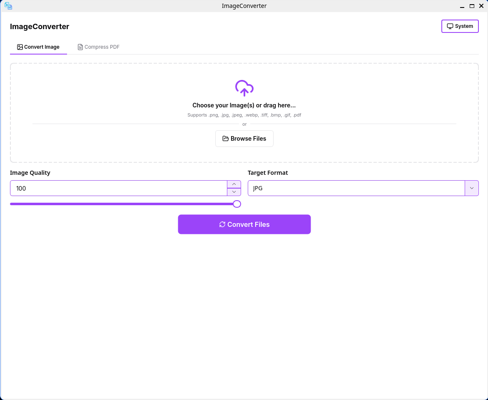
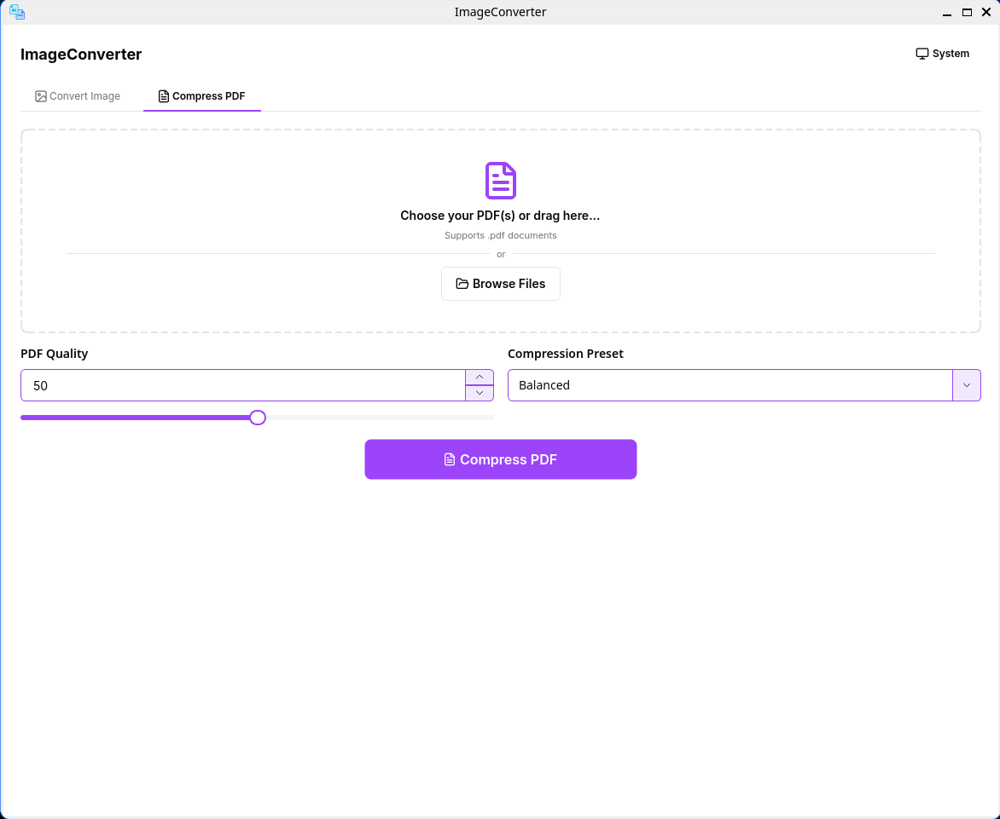

# ImageConverter

[](https://opensource.org/licenses/MIT)
[](https://github.com/illufoxKusanagi/image-converter/releases)
[](#)
[](https://isocpp.org/)
[](https://www.qt.io/)

<p align="center">
  
  
</p>

**ImageConverter (v1.2.0)** is a native, 100% offline C++17 / Qt 6 desktop application for batch image conversion and local PDF processing (compression, merging, splitting, page organization, page extraction, image-to-PDF assembly, and grayscale conversion), built on a custom 30-component Qt Widgets design system (`ui-kit`).

---

## Table of Contents

- [Overview & Design Principles](#overview--design-principles)
- [Features](#features)
  - [Image Conversion](#image-conversion)
  - [PDF Tools](#pdf-tools)
  - [UI-Kit Design System](#ui-kit-design-system)
- [Screenshots](#screenshots)
- [Tech Stack](#tech-stack)
- [Architecture & Directory Layout](#architecture--directory-layout)
- [Installation](#installation)
- [Usage Guide](#usage-guide)
- [Building from Source](#building-from-source)
- [Packaging](#packaging)
- [Changelog](#changelog)
- [Contributing](#contributing)
- [License](#license)
- [Contact](#contact)

---

## Overview & Design Principles

Most document and image conversion utilities require uploading private files to third-party servers, enforce arbitrary file-size caps or daily quotas, or bundle heavy web runtimes. **ImageConverter** is engineered around three core principles:

1. **Strict Local Execution**: Every image conversion and PDF operation runs locally on your machine. The application makes zero network calls, collects zero telemetry or analytics, and imposes no file-size limits or usage quotas.
2. **Data Integrity & Atomic Saves**: File outputs are staged through temporary directories (`QTemporaryDir`) and committed using atomic `QSaveFile` operations (`setDirectWriteFallback(false)`). Candidate PDFs are validated against `QPdfDocument` for page count and point-dimension integrity before any destination file is written, ensuring original files are never corrupted or overwritten on failure or cancellation.
3. **Dual-Engine PDF Processing**: When Ghostscript (`gs` / `gswin64c`) is available, PDF operations use the `pdfwrite` distiller pipeline to preserve vector text, paths, and embedded fonts while optimizing or transforming embedded streams. When Ghostscript is absent or cannot process a specific file, the application automatically falls back to Qt's native `QPdfDocument` and `QPdfWriter` pipeline.

---

## Features

### Image Conversion

Implemented in `MainPage` and `DropFileWidget`:

- **Supported Formats**: `JPG`, `JPEG`, `PNG`, `WEBP`, `TIFF`, `BMP`, `GIF`, and `PDF`.
- **Three Conversion Workflows**:
  1. **Image to Image**: Single or batch conversion across raster formats with synchronized slider and spinbox quality control (`0-100` for lossy/configurable encoders; automatic `-1` lossless compression for `PNG`).
  2. **Images to Multi-Page PDF**: Combines one or more queued raster images into a single multi-page PDF document with page resolution scaled according to the quality slider.
  3. **PDF to Images**: Renders single-page or multi-page PDF documents into the selected raster image format, composited over a clean white paper background (`renderPdfPageOnWhite`) so transparent PDF pages never render with dark or uninitialized backdrops.
- **Interactive Queue Management (`DropFileWidget`)**:
  - Drag-and-drop files directly from the system file manager or browse via native file dialogs.
  - Automatic duplicate detection, formatted file size display (`B`, `KB`, `MB`), individual item removal, **Add More**, and **Clear All** actions.
  - Live per-file status badges (`Waiting`, `Processing`, `Succeeded`, `Unchanged`, `Failed`, `Cancelled`) paired with an inline animated spinner during active batch jobs.
  - Multi-threaded background execution via `QtConcurrent` and `QFutureWatcher` with responsive cancellation support.

### PDF Tools

Implemented in `PdfPage` and the headless `controllers/` layer. All seven PDF tools operate offline and report per-file progress and completion metrics.

| Tool | Input -> Output | Primary Engine / Fallback | Key Options & Safeguards |
| :--- | :--- | :--- | :--- |
| **Compress PDF** (`CompressController`) | 1+ PDFs -> 1+ optimized PDFs | Ghostscript (`pdfwrite`) / `QPdfDocument` + `QPdfWriter` | Quality presets (`20`, `50`, `80`, `Custom 0-100`), Smart Size Guard (`Unchanged` if output >= source) |
| **Merge PDF** (`MergeController`) | 2+ PDFs -> 1 combined PDF | Ghostscript multi-input `pdfwrite` / `QPdfDocument` + `QPdfWriter` | Interactive **Merge Order** list (drag-and-drop, `Move Up`, `Move Down`, `Sync from Drop Zone`), total page count validation |
| **Split PDF** (`SplitController`) | 1 PDF -> Multiple PDFs in target folder | Ghostscript (`-dFirstPage` / `-dLastPage`) / `QPdfDocument` + `QPdfWriter` | Custom 1-based page ranges (`1-3, 5, 8-12`), fixed interval (`Every N pages`), or extract every page individually |
| **Organize / Rotate / Delete Pages** (`OrganizeController`) | 1 PDF -> 1 reorganized PDF | `QPdfDocument` + `QPdfWriter` (300 DPI `ExactMatch`) | Live page thumbnail list, multi-selection, `-90°` / `+90°` / `180°` rotation, drag-and-drop reordering, page deletion guard, reset |
| **PDF to Images** (`PdfToImagesController`) | 1 PDF -> Page images (`PNG`, `JPG`, `WEBP`, `TIFF`) | `QPdfDocument` (`renderPdfPageOnWhite`) | Output format selector, target DPI (`72`, `150`, `300`, `600 DPI`), all pages or custom 1-based page range filter |
| **Images to Merged PDF** (`ImagesToPdfController`) | 1+ Images -> 1 multi-page PDF | `QImageReader` (EXIF auto-orient) + `QPdfWriter` | Drag-and-drop image ordering, Page Size (`Fit to Image`, `A4`, `Letter`), Orientation (`Auto`, `Portrait`, `Landscape`), Margin (`0-54 pt`) |
| **PDF to Grayscale** (`GrayscaleController`) | 1+ PDFs -> 1+ grayscale PDFs | Ghostscript (`/DeviceGray`) / `QImage::Format_Grayscale8` + `QPdfWriter` | Single or batch monochrome conversion, preserves vector text via Ghostscript |

#### 1. Compress PDF (`CompressController`)
- **Compression Presets**:
  - `Web / Email` (Quality `20`)
  - `Balanced` (Quality `50`)
  - `High Quality (preserve images)` (Quality `80`)
  - `Custom` (Quality `0-100`, automatically selected when adjusting the slider manually)
- **Adaptive Stream Encoding**:
  - Below quality `80`: Downsamples embedded color and grayscale images (`100-300 DPI` bicubic) and tunes Ghostscript `pdfwrite` JPEG `QFactor` without aggressive chroma subsampling (`HSamples [1 1 1 1]` / `VSamples [1 1 1 1]`) to keep text and line art sharp.
  - At quality `80` and above: Disables lossy JPEG re-encoding of color/grayscale images and preserves native image resolution with lossless `FlateEncode` while stripping redundant PDF objects and compressing uncompressed streams.
- **Smart Size Guard**: Compares the validated candidate PDF size against the original file. If re-encoding does not reduce the file size, the original file is kept untouched (or copied cleanly when saving to a new path) and marked as `Unchanged (already optimal)`.

#### 2. Merge PDF (`MergeController`)
- Combines two or more PDF files into a single output document.
- Provides an interactive **Merge Order** card where files can be reordered via drag-and-drop, **Move Up**, **Move Down**, or re-synchronized with the drop zone via **Sync from Drop Zone**.
- Verifies that the merged output PDF contains the exact sum of pages across all input documents before atomic commit.

#### 3. Split PDF (`SplitController`)
- Splits a source PDF into multiple output PDFs inside a user-selected destination directory using one of three modes:
  - **Custom Page Ranges**: Accepts 1-based comma-separated pages and ranges (for example, `1-3, 5, 8-12`). Each token produces a dedicated output PDF (`<basename>_pages_1-3.pdf`, `<basename>_page_5.pdf`).
  - **Fixed Interval**: Splits the document every `N` pages (`1-1000`), automatically clamping the final chunk to the document's last page.
  - **Extract All Pages**: Exports every page of the source PDF as an individual `<basename>_page_N.pdf` file.

#### 4. Organize / Rotate / Delete Pages (`OrganizeController`)
- Renders miniature page thumbnails (`56x72` icon slots with annotations and preserved aspect ratio) as soon as a PDF is dropped.
- Supports single and multi-page selection with actions to **Rotate Left (-90°)**, **Rotate Right (+90°)**, **Rotate 180°**, **Move Up**, **Move Down**, **Delete Page** (with a safeguard preventing deletion of the final remaining page), and **Reset** to restore the original page sequence and orientations.
- Exports the modified page sequence at `300 DPI` using `QPageSize::ExactMatch` point dimensions, swapping page width and height whenever a net `90°` or `270°` rotation is applied.

#### 5. PDF to Images (`PdfToImagesController`)
- Exports either all pages or a custom 1-based page selection (`1-3, 5`) from a PDF into a chosen output folder.
- Configurable **Image Format** (`PNG` with lossless `-1` compression, or `JPG`, `WEBP`, `TIFF` at quality `92`) and **Render DPI** (`72 DPI`, `150 DPI`, `300 DPI`, or `600 DPI`).
- Renders every page over an opaque white canvas (`renderPdfPageOnWhite`) with annotations enabled.

#### 6. Images to Merged PDF (`ImagesToPdfController`)
- Automatically switches the `PdfPage` drop zone to accept image files (`JPG`, `JPEG`, `PNG`, `WEBP`, `BMP`, `TIFF`, `GIF`).
- Provides an interactive **Image Page Order** list supporting drag-and-drop reordering, **Move Up**, **Move Down**, and **Sync from Drop Zone**.
- Reads images with `QImageReader::setAutoTransform(true)` so camera EXIF orientation tags are honored automatically.
- Configurable layout options:
  - **Page Size**: `Fit to Image` (`72 DPI` 1:1 pixel-to-point mapping), `A4`, or `Letter`
  - **Orientation**: `Auto (Match Image)`, `Portrait`, or `Landscape`
  - **Page Margin**: `None (0 pt)`, `Small (18 pt)`, `Medium (36 pt)`, or `Large (54 pt)`

#### 7. PDF to Grayscale (`GrayscaleController`)
- Converts single or multiple PDF files to monochrome (`/DeviceGray`).
- Uses Ghostscript (`-sColorConversionStrategy=Gray -dProcessColorModel=/DeviceGray`) to convert color spaces while keeping vector text intact, or falls back to `QImage::Format_Grayscale8` page rendering via `QPdfWriter`.

### UI-Kit Design System

`ImageConverter` is built on `ui_kit` (`ui-kit/`), a standalone, zero-dependency C++17 Qt Widgets static library inspired by Shadcn UI:

- **Tokenized Theme Engine (`ui::Theme`)**: Instant runtime switching between **Light**, **Dark**, and **System** (OS-synchronized) themes without restarting the application. All colors (`ThemeColors`), spacing (`ThemeSpacing`), corner radii (`ThemeRadius`), and font scales (`ThemeTypography`) are resolved dynamically without hardcoded QSS hex values.
- **30 Reusable Qt Widgets Components**:
  - `Accordion`, `Alert`, `Avatar`, `Badge`, `Button` (with child `Spinner` loading state), `Card`, `Checkbox` (including tri-state and error states), `Combobox` (searchable model/proxy popup), `Dialog`, `EmptyState`, `FormField`, `Input`, `Menu` (`DropdownMenu` / `ContextMenu`), `NumberInput` / `DecimalInput`, `Popover`, `Progress`, `RadioGroup`, `ScrollArea`, `Select`, `Separator`, `Sidebar`, `Slider`, `Spinner`, `Splitter` (keyboard-accessible handle), `Switch`, `Table`, `Tabs`, `Textarea`, `Toast`, and `Tooltip`.
- **Dedicated Documentation & Standalone Demo**:
  - Library reference and CMake integration guide: [`ui-kit/README.md`](ui-kit/README.md)
  - AI agent component API & rules guide: [`ui-kit/AI_AGENT_GUIDE.md`](ui-kit/AI_AGENT_GUIDE.md)
  - Interactive 30-component showcase executable: build with `-DUI_KIT_BUILD_DEMO=ON` to produce the standalone `ui_kit_demo` binary (`ui-kit/demo/`).

---

## Screenshots

### Image Conversion


### PDF Tools


---

## Tech Stack

| Layer | Technology |
| :--- | :--- |
| **Language** | C++17 (`CMAKE_CXX_STANDARD 17`) |
| **Framework** | Qt 6 (`Core`, `Gui`, `Widgets`, `Pdf`, `Concurrent`, `Svg`) with Qt 5 fallback support |
| **Design System** | Custom static `ui_kit` library (`ui-kit/`) + bundled Lucide SVG icons via `CMAKE_AUTORCC` |
| **PDF Engines** | Ghostscript (`pdfwrite` CLI pipeline) + Qt PDF (`QPdfDocument` / `QPdfWriter`) automatic fallback |
| **Build & Packaging** | CMake 3.16+, Ninja, CPack (`.deb`, `.rpm`, Windows portable `.zip`) |

---

## Architecture & Directory Layout

```text
ImageConverter/
├── .github/workflows/                # CI/CD release pipelines (Linux .deb/.rpm & Windows .zip)
├── controllers/                      # Headless PDF processing engines & background task controllers
│   ├── pdf_tool_controller.h/.cpp    # Abstract QObject base class (CancellationToken, ProgressCallback)
│   ├── pdf_engine_utils.h/.cpp       # Ghostscript lookup, PDF validation, white-page rendering, range parser
│   ├── compress_controller.h/.cpp    # Single & batch PDF compression (Ghostscript + Qt fallback)
│   ├── merge_controller.h/.cpp       # Multi-PDF merging with total page count verification
│   ├── split_controller.h/.cpp       # PDF splitting (custom ranges, fixed intervals, extract all)
│   ├── organize_controller.h/.cpp    # Thumbnail loading, per-page rotation, reordering & deletion
│   ├── pdf_to_images_controller.h/.cpp # PDF page export to PNG/JPG/WEBP/TIFF at 72-600 DPI
│   ├── images_to_pdf_controller.h/.cpp # Image sequence to PDF assembly (page size, orientation, margins)
│   └── grayscale_controller.h/.cpp   # Single & batch monochrome (/DeviceGray) PDF conversion
├── mainwindow/                       # Top-level shell window, header bar, theme toggle & tab routing
│   └── mainwindow.h/.cpp
├── pages/                            # Application views
│   ├── main_page.h/.cpp              # Image conversion UI & asynchronous batch orchestration
│   └── pdf_page.h/.cpp               # Unified 7-mode PDF Toolkit UI & controller coordination
├── widgets/                          # Application-specific composite widgets
│   ├── drop_file_widget.h/.cpp       # Drag-and-drop file queue, status badges & image save helpers
│   ├── slider_widget.h/.cpp          # Synchronized slider + spinbox quality control
│   ├── button_action.h/.cpp          # Primary action button wrapper
│   ├── input_widget.h/.cpp           # Labeled form input & format selector
│   └── message_box_widget.h/.cpp     # Styled modal alert dialog wrapper
├── ui-kit/                           # Standalone Qt Widgets component library (static target: ui_kit)
│   ├── theme/                        # Tokens, Theme manager, StyleHelper, AnimationHelper, Icons
│   ├── components/                   # 30 reusable UI components (Button, Card, Combobox, Dialog, etc.)
│   ├── demo/                         # Standalone interactive showcase (target: ui_kit_demo)
│   ├── README.md                     # Standalone documentation for embedding ui-kit in other projects
│   └── AI_AGENT_GUIDE.md             # Component usage rules and API reference for AI coding agents
├── resources/                        # Qt Resource manifest (icons.qrc) & Lucide SVG vector assets
├── styles/                           # Legacy text and color helpers
├── CHANGELOG.md                      # Release history and versioned architectural changes
├── improvement-todo.md               # Engineering roadmap and verified milestone checklist
├── CMakeLists.txt                    # Root CMake build & CPack packaging configuration
└── main.cpp                          # Application entry point & theme initialization
```

### UI-to-Controller Separation
- **View Layer (`pages/pdf_page.*`)**: Manages mode selection, dynamic option cards, file dialogs, and progress UI updates on the Qt GUI thread.
- **Controller Layer (`controllers/*`)**: Subclasses of `PdfToolController` encapsulate all file I/O, Ghostscript process execution, and `QPdfDocument` / `QPdfWriter` rendering on background worker threads via `QtConcurrent::run`. Controllers have zero `QWidget` dependencies and communicate exclusively through thread-safe `CancellationToken` flags, `ProgressCallback` invocables, and `TaskResult` structures.

### Ghostscript Discovery Order
`PdfEngineUtils::findGhostscriptExecutable()` locates the Ghostscript binary in the following priority order:
1. `IMAGECONVERTER_GHOSTSCRIPT` environment variable (if set to a valid executable path).
2. Bundled portable binary alongside the application executable (`<appDir>/gs/bin/gswin64c.exe` on Windows or `<appDir>/gs/bin/gs` on Linux).
3. System `PATH` (`gswin64c`, `gswin32c`, or `gs`).
4. If no Ghostscript binary is found, operations automatically use the built-in Qt PDF (`QPdfDocument` + `QPdfWriter`) engine.

---

## Installation

Download the latest pre-built release packages from [**GitHub Releases**](https://github.com/illufoxKusanagi/image-converter/releases):

### Windows (Portable `.zip`)
1. Download `ImageConverter-windows-x64.zip` from the latest release.
2. Extract the archive to any folder.
3. Run `ImageConverter.exe` (no installer required; includes bundled Ghostscript for vector-preserving PDF operations).

### Debian / Ubuntu (`.deb`)
```bash
sudo apt install ./image-converter-*.deb
```

### Fedora / RHEL (`.rpm`)
```bash
sudo dnf install ./image-converter-*.rpm
```

---

## Usage Guide

### 1. Convert Images (`Convert Image` Tab)
1. Open the **Convert Image** tab.
2. Drag and drop one or more image or PDF files into the drop zone, or click to browse.
3. Adjust the **Image Quality** slider (`0-100`) and choose the target **Output Format** (`JPG`, `JPEG`, `PNG`, `WEBP`, `TIFF`, `BMP`, `GIF`, or `PDF`).
4. Click **Convert Files**:
   - For a single input file, choose the output file path in the save dialog.
   - For multiple input files (or when converting a multi-page PDF to images), choose the output folder. When converting multiple images into `PDF`, you can choose to combine all images into a single multi-page PDF or export separate PDFs.

### 2. Process PDFs (`PDF Tools` Tab)
1. Switch to the **PDF Tools** tab and select one of the seven tools from the **PDF Tool** selector:
   - **Compress PDF**: Drop one or more PDFs, pick a preset (`Web / Email`, `Balanced`, `High Quality`, or `Custom`), and click **Compress PDF**.
   - **Merge PDF**: Drop at least two PDFs, arrange their sequence in the **Merge Order** list, and click **Merge PDFs** to save the combined file.
   - **Split PDF**: Drop a PDF, select `Custom Page Ranges` (e.g., `1-3, 5, 8-12`), `Fixed Interval (Every N Pages)`, or `Extract All Pages (1 Page per PDF)`, and click **Split PDF** to choose an output directory.
   - **Organize / Rotate / Delete Pages**: Drop a PDF to load page thumbnails, use the toolbar buttons or drag-and-drop to rotate, reorder, or remove pages, and click **Save Organized PDF**.
   - **PDF to Images**: Drop a PDF, select the **Image Format** (`PNG`, `JPG`, `WEBP`, `TIFF`), **Render DPI** (`72-600 DPI`), and **Pages to Export** (`All Pages` or `Custom Range`), then click **Export PDF to Images**.
   - **Images to Merged PDF**: Drop one or more images, arrange their page order, select **Page Size** (`Fit to Image`, `A4`, `Letter`), **Orientation**, and **Page Margin**, then click **Create PDF from Images**.
   - **PDF to Grayscale**: Drop one or more PDFs and click **Convert to Grayscale** to produce monochrome PDFs.

### 3. Switching Themes
- Click the **Theme** button in the top-right header bar to cycle between **System**, **Light**, and **Dark** themes at runtime.

---

## Building from Source

### 1. Install Dependencies

#### Ubuntu / Debian
```bash
sudo apt update
sudo apt install -y build-essential cmake ninja-build \
  qt6-base-dev qt6-pdf-dev qt6-svg-dev libgl1-mesa-dev ghostscript
```

#### Fedora
```bash
sudo dnf install -y gcc-c++ cmake ninja-build \
  qt6-qtbase-devel qt6-qtpdf-devel qt6-qtsvg-devel mesa-libGL-devel ghostscript
```

#### Windows
- Install **Qt 6.x** via the [Qt Online Installer](https://www.qt.io/download), selecting **Qt PDF** and **Qt SVG** modules alongside **MinGW 64-bit** or **MSVC 2022 64-bit**.
- Ensure **CMake 3.16+** and **Ninja** are available in `PATH`.
- *(Optional)* Install **Ghostscript** (`gswin64c.exe`) in `PATH` or place a portable Ghostscript build under `gs/bin/` next to the compiled executable.

### 2. Compile the Application

```bash
git clone https://github.com/illufoxKusanagi/image-converter.git
cd image-converter

cmake -B build -G Ninja -DCMAKE_BUILD_TYPE=Release
cmake --build build --parallel
```

### 3. Build the Standalone UI-Kit Demo (Optional)

To build and launch the interactive 30-component `ui_kit_demo` showcase application:

```bash
cmake -B build -G Ninja -DCMAKE_BUILD_TYPE=Release -DUI_KIT_BUILD_DEMO=ON
cmake --build build --target ui_kit_demo --parallel
./build/ui-kit/ui_kit_demo
```

### 4. Building in Qt Creator
1. Launch **Qt Creator** and open `CMakeLists.txt` from the repository root.
2. Select a configured **Qt 6** kit (GCC/Clang on Linux, or MinGW 64-bit / MSVC 64-bit on Windows).
3. Build (`Ctrl+B`) and run (`Ctrl+R`).

---

## Packaging

After building in `Release` mode, generate installable packages using `cpack`:

```bash
cd build
cpack -G DEB   # Debian / Ubuntu package (.deb)
cpack -G RPM   # Fedora / RHEL package (.rpm)
cpack -G ZIP   # Portable archive (.zip)
```

---

## Changelog

See [`CHANGELOG.md`](CHANGELOG.md) for versioned release notes and [`improvement-todo.md`](improvement-todo.md) for the completed engineering roadmap.

---

## Contributing

1. Fork the repository.
2. Create a feature branch (`git checkout -b feature/your-feature`).
3. Verify your changes compile cleanly with `cmake --build build --parallel`.
4. Commit your changes and open a Pull Request.

---

## License

This project is licensed under the **MIT License** — see the [`LICENSE`](LICENSE) file for details.

---

## Contact

Project Repository: [https://github.com/illufoxKusanagi/image-converter](https://github.com/illufoxKusanagi/image-converter)
