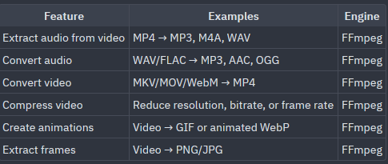

# ImageConverter — Feature & Conversion Roadmap (A → B)

All planned conversions prioritize **100% offline, local execution** with zero cloud dependencies—leveraging existing **Qt 6** and **Ghostscript** primitives, or optional lightweight local CLI/plugin engines (`FFmpeg`, `kimageformats`).

---

## 1. PDF Toolkit (iLovePDF-Style Local Operations)

High-value document workflows built directly on top of the existing `QPdfDocument`, `QPdfWriter`, and `Ghostscript` pipeline:

| Status | Feature | A → B Examples | Engine / Foundation | Notes |
| :---: | :--- | :--- | :--- | :--- |
| [ ] | **Merge PDF** | `Multiple PDFs → 1 combined PDF` | `Ghostscript` / `QPdfDocument` + `QPdfWriter` | Drag-and-drop file ordering before merging. |
| [ ] | **Split PDF** | `1 PDF → Multiple PDFs` | `Ghostscript` (`-dFirstPage`/`-dLastPage`) / `QPdfDocument` | Split by custom page ranges (`1-3, 5, 8-12`), fixed intervals (every `N` pages), or extract all pages into individual PDFs. |
| [ ] | **Organize / Rotate / Delete PDF Pages** | `PDF → Reordered / Rotated / Trimmed PDF` | `QPdfDocument` + `QPdfWriter` / `Ghostscript` | Rotate pages (`90° / 180° / 270°`), delete unwanted pages, or reorder page thumbnails. |
| [ ] | **PDF to Images (Page Extractor)** | `PDF → PNG, JPG, WEBP, TIFF` | `QPdfDocument::render()` | Export all pages or selected page ranges at configurable DPI (`72–600 DPI`). |
| [ ] | **Images to Merged PDF** | `Multiple PNG/JPG/WEBP → 1 multi-page PDF` | `QPdfWriter` + `QPainter` | Combine queued images into a single document with page size (`A4`, `Letter`, `Fit Image`), orientation, and margin options. |
| [ ] | **PDF to Grayscale** | `Color PDF → Grayscale PDF` | `Ghostscript` (`-sColorConversionStrategy=Gray`) / `QPdfDocument` | Convert color PDFs to grayscale to reduce size and prepare for black-and-white printing. |

---

## 2. Image, Vector & Developer Conversions

Native Qt 6 and lightweight plugin extensions for designers, photographers, and developers:

| Status | Feature | A → B Examples | Engine / Foundation | Notes |
| :---: | :--- | :--- | :--- | :--- |
| [ ] | **Vector SVG to Raster / PDF** | `SVG → PNG, WEBP, JPG, PDF` | `QSvgRenderer` (`Qt6::Svg`) | Custom width/height or crisp `1x / 2x / 4x` vector scaling before rasterization. |
| [ ] | **Image to Multi-Size `.ico` (App Icon)** | `PNG / SVG → .ico` | `QImage` + ICO container writer | Pack `16, 32, 48, 64, 128, 256 px` resolutions into a single Windows `.ico` file. |
| [ ] | **Next-Gen Photo Formats** | `HEIC / HEIF / AVIF / JXL → JPG, PNG, WEBP, PDF` | `libheif` / `libavif` / `kimageformats` | Offline conversion for iPhone `.heic` photos and modern web formats. |
| [ ] | **Camera RAW Conversion** | `CR2 / NEF / ARW / DNG → TIFF, JPG, PNG` | `libraw` / `kdcraw` | Batch-convert camera RAW shoots without heavy photo suites. |
| [ ] | **Markdown / HTML to PDF** | `.md / .html → .pdf` | `QTextDocument::setMarkdown()` + `QPdfWriter` | Zero-dependency document export built into `Qt6::Gui`. |
| [ ] | **Image ↔ Base64 Data URI** | `PNG / JPG / SVG / WEBP ↔ data:image/...;base64,...` | `QByteArray::toBase64()` | Copy/export inline HTML/CSS/JSON data URIs or decode Base64 strings back to image files. |

---

## 3. Audio & Video Conversions (Optional `FFmpeg` Subprocess Engine)

Using a local `ffmpeg` binary via `QProcess` (matching the existing `Ghostscript` subprocess pattern in `PdfPage`):

| Status | Feature | A → B Examples | Engine | Notes |
| :---: | :--- | :--- | :--- | :--- |
| [ ] | **Extract Audio from Video** | `MP4 / MKV / MOV / WebM → MP3, M4A, WAV, FLAC` | `FFmpeg` | Extract audio tracks with bitrate/format selection. |
| [ ] | **Convert Audio** | `WAV / FLAC / OGG / M4A → MP3, AAC, OGG, WAV, FLAC` | `FFmpeg` | Batch audio transcoding with sample rate and bitrate controls. |
| [ ] | **Convert Video** | `MKV / MOV / WebM / AVI → MP4, WebM, MKV` | `FFmpeg` | Standard video container & codec conversion. |
| [ ] | **Fast Lossless Container Remux** | `MKV / MOV / TS → MP4` (`-c copy`) | `FFmpeg` | Instant stream copy without re-encoding or quality loss. |
| [ ] | **Compress Video** | `MP4 / MKV / MOV → Smaller MP4` | `FFmpeg` | Reduce resolution (`1080p / 720p / 480p`), CRF/bitrate, or frame rate. |
| [ ] | **Create Animations** | `Video → GIF or Animated WebP` | `FFmpeg` | Palette-optimized GIF and animated WebP generation with FPS/scale controls. |
| [ ] | **Extract Video Frames** | `Video → PNG / JPG` | `FFmpeg` | Extract frames at specific intervals, timestamps, or scene changes. |
| [ ] | **Image Sequence to Video / Animation** | `img_001.png … img_120.png → MP4, WebM, GIF` | `FFmpeg` | Stitch numbered image frames into video or animation at target FPS. |
| [ ] | **Audio + Static Cover Art to Video** | `MP3 / WAV + PNG/JPG → MP4` | `FFmpeg` | Generate static-cover video files for podcast/social uploads. |
| [ ] | **Subtitle Extraction & Conversion** | `MKV → SRT / ASS` or `SRT ↔ VTT` | `FFmpeg` | Extract embedded subtitle tracks or convert subtitle formats. |

---

## 4. Explicitly Out of Scope

- **Office Documents (`DOCX / PPTX / XLSX → PDF`)**: Excluded by design. Accurate Office rendering requires bundling a massive layout engine (hundreds of MBs), which conflicts with keeping ImageConverter fast, lightweight, and self-contained.
